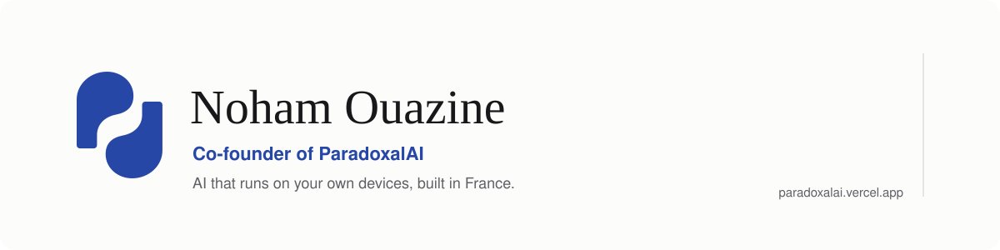

<picture>
  <source media="(prefers-color-scheme: dark)" srcset="./assets/banner-dark.svg">
  
</picture>

Hi, I'm Noham. I'm 16, I live in France, and with my friend [Reel](https://github.com/Vyn042) I run **[ParadoxalAI](https://paradoxalai.vercel.app)**.

We train our own language model, **Vertigo**, from scratch: our code, our data, our training runs, on a gaming graphics card. Not a model from somewhere else with a new coat of paint. It is small, it is honest, and it is ours.

### What we build

| | |
|---|---|
| **Vertigo** | A French assistant that runs on your own phone or computer, even offline. It looks facts up instead of guessing, and every answer comes with a receipt: who answered and what was checked. Nothing you write leaves your device. |
| **PARADOXAL Code** | A coding agent in the desktop app and in your terminal. It reads your project, proposes a plan, and changes nothing without your yes. Works with our model, or with the one you already use. |
| **PARADOXAL-R** | A small model that solves the hardest Sudoku grids and checks its own answer. |
| **Möbi** | Our mascot. A loop with one side, in pixels. It looks around while Vertigo thinks. |

**Try it:** [chat on your phone or in your browser](https://paradoxalai.vercel.app/chat) · [desktop app](https://paradoxalai.vercel.app/download) · [terminal, one command](https://paradoxalai.vercel.app/cli)

### How we work

A small model, given time to think. A lab that tests one idea at a time, overnight, and keeps only what the numbers confirm. Everything we ship runs on the device of the person using it.

### What I work with

Python and PyTorch · TypeScript, React and Next.js · Electron · C++ and Win32

### Elsewhere

[paradoxalai.vercel.app](https://paradoxalai.vercel.app) · [LinkedIn](https://www.linkedin.com/in/noham-ouazine-245620348/)
